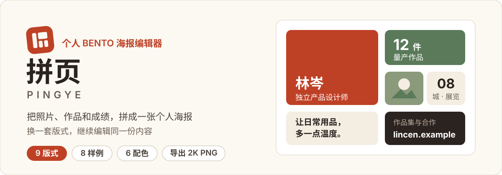
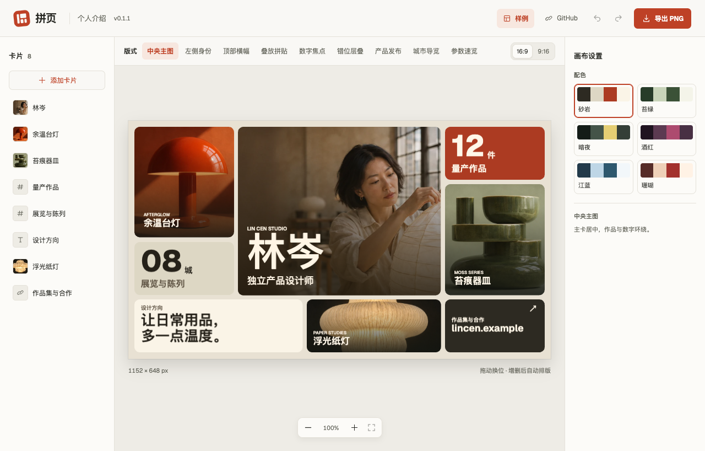
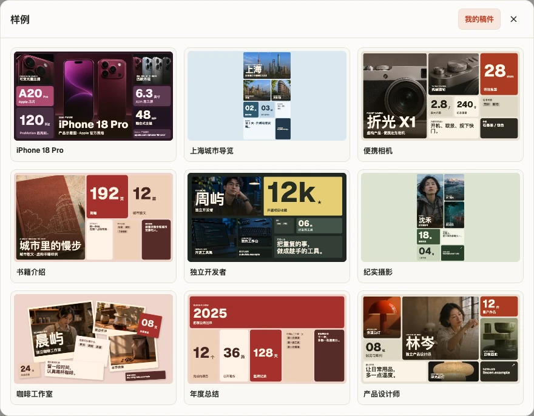
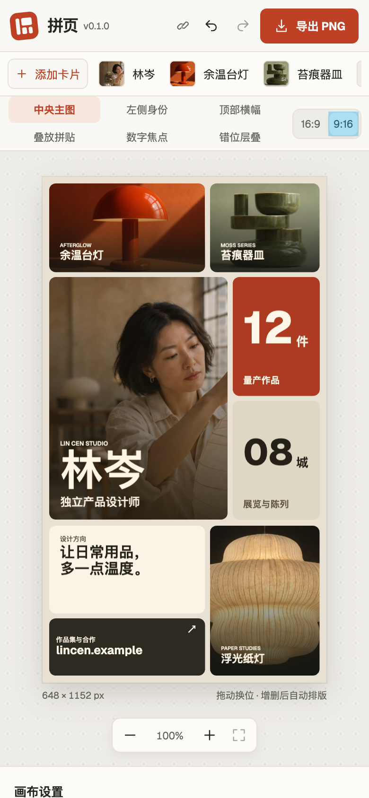
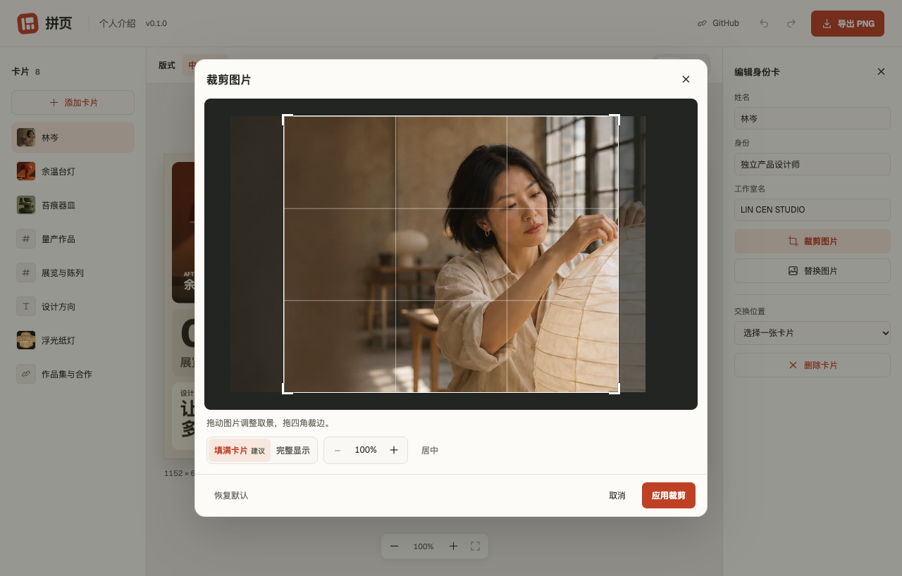

<p align="right"><a href="README.md">中文</a></p>

<p align="center">
  
</p>

<p align="center">
  <a href="https://xiaosang.cc/pingye/">▶ Try Online</a>
  ·
  <a href="https://github.com/holynova/pingye">GitHub Repository</a>
</p>

Pingye is a browser-based Bento poster editor for personal introductions and portfolios: turn photos, projects, and milestones into one poster. Fill in your content once, switch freely among nine layouts that reflow automatically, then export a 2K PNG. Drafts and uploaded images stay in your browser — nothing is uploaded.

## Screenshots

<p align="center">
  
</p>

<p align="center">
  
</p>

<p align="center">
  
  
</p>

## Features

- **6 card types**: identity, image, metric, quote, tags, link — add, remove, and reorder; layouts reflow automatically.
- **9 layouts**: 中央主图 (center hero), 左侧身份 (left identity), 顶部横幅 (top banner), 叠放拼贴 (stacked collage), 数字焦点 (metric focus), 错位层叠 (offset layers), 产品发布 (product launch), 城市导览 (city guide), 参数速览 (spec sheet); one draft, switch layouts without losing content.
- **2 aspect ratios**: 16:9 landscape and 9:16 phone, one click to switch.
- **6 themes**: 砂岩 (clay), 苔绿 (moss), 暗夜 (ink), 酒红 (plum), 江蓝 (slate), 珊瑚 (rose); each layout has a default theme, or pick one yourself.
- **Image cropping**: tap 「裁剪」 ("Crop") on an image, drag, zoom, or drag the corners to reframe, with rule-of-thirds guides, up to 5× zoom.
- **8 editable examples**: iPhone 18 Pro, Shanghai city guide, portable camera, book intro, indie developer, documentary photography, coffee studio, year in review — each saved separately, switch back to 「我的稿件」 ("My Draft") anytime.
- **Export**: 2304 × 1296 (landscape) or 1296 × 2304 (phone), rendered on Canvas at 2× supersampling.
- **Local saving**: drafts and uploaded images live in browser localStorage; undo and redo supported.

## Notes

- The iPhone 18 Pro and Shanghai examples use illustrative diagrams. Specs and locations reference [Apple Tech Specs](https://support.apple.com/en-la/148590) and the [Shanghai City Walk Guide](https://english.shanghai.gov.cn/en-FAQs-StudyinShanghai/20251124/9f1658ae899240d19c52784bddfed782.html).
- Exported files are named 「拼页-稿件名-16x9/9x16.png」 ("Pingye-DraftName-16x9/9x16.png").

## Run Locally

```bash
npm ci
npm run build   # Produces the single-file dist/index.html
npm run dev     # Local preview
```

The build script packs `src/index.html`, `src/app.js`, and fonts into a single standalone HTML file; check with `npm run check`.

## Tech

- Zero frameworks: vanilla HTML/CSS/JavaScript, Canvas-rendered export images (2× supersampling).
- Themes and layouts are data-driven (`templates` / `themes` / `kinds` in `src/app.js`); example data in `src/examples.json`, demo images in `src/demo/`.

```
src/index.html      Editor UI
src/app.js          All editing, layout, cropping, and export logic
src/examples.json   8 example drafts
src/demo/           Example demo images (WebP)
src/fonts/          Geist font (OFL)
scripts/build.mjs   Single-file bundling
```
