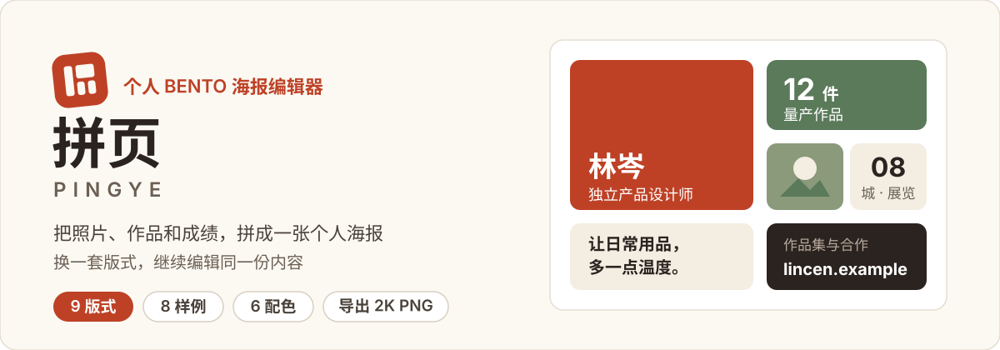
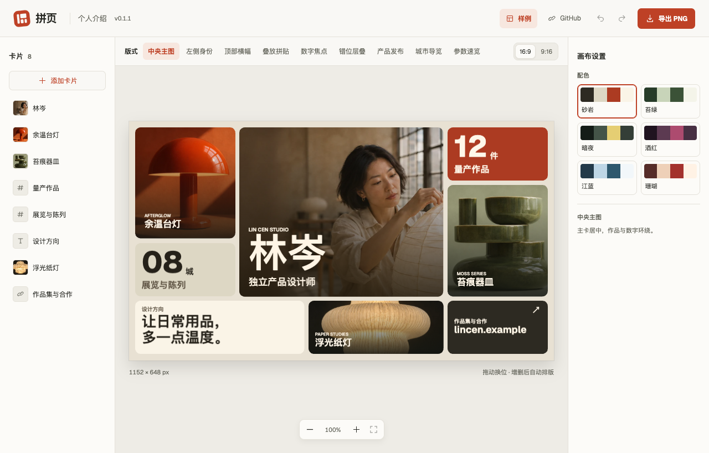
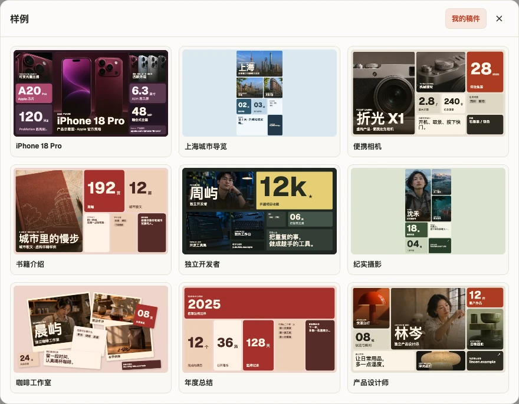

<p align="center">
  
</p>

<p align="center">
  <a href="https://xiaosang.cc/pingye/">▶ 在线体验 Try Online</a>
  ·
  <a href="https://github.com/holynova/pingye">GitHub 仓库</a>
</p>

拼页是一款浏览器里的个人 Bento 海报编辑器：把照片、作品和成绩拼成一张海报。填一次内容，九种版式随便换，版式会自动重排；调好后导出 2K PNG。草稿和上传的图片只保存在当前浏览器，不上传服务器。

Pingye is a browser-based Bento poster editor for personal introductions and portfolios: turn photos, projects, and milestones into one poster. Fill in your content once, switch freely among nine layouts that reflow automatically, then export a 2K PNG. Drafts and uploaded images stay in your browser — nothing is uploaded.

## 截图 / Screenshots

<p align="center">
  
</p>

<p align="center">
  
</p>

<p align="center">
  
  
</p>

## 功能 / Features

- **六种卡片**：身份、图片、数字、文案、标签、链接；增删拖拽后版式自动调整。
- **九种版式**：中央主图、左侧身份、顶部横幅、叠放拼贴、数字焦点、错位层叠、产品发布、城市导览、参数速览；同一份稿件，换版式不丢内容。
- **两种画幅**：横屏 16:9 与手机竖屏 9:16，一键切换。
- **六种配色**：砂岩、苔绿、暗夜、酒红、江蓝、珊瑚；每套版式有默认配色，也可单独指定。
- **图片裁剪**：点图片上的「裁剪」，拖动、缩放或拖四角调整取景，带三分线参考，最大 5 倍缩放。
- **八套样例**：iPhone 18 Pro、上海城市导览、便携相机、书籍介绍、独立开发者、纪实摄影、咖啡工作室、年度总结；每套单独保存，可随时切回「我的稿件」。
- **导出 PNG**：横屏 2304 × 1296，手机竖屏 1296 × 2304。
- **本地保存**：草稿与上传图片存在浏览器 localStorage；支持撤销与重做。

## 说明 / Notes

- iPhone 18 Pro 与上海样例使用示意图。规格与地点参考 [Apple 技术规格](https://support.apple.com/en-la/148590) 和 [上海城市漫步指南](https://english.shanghai.gov.cn/en-FAQs-StudyinShanghai/20251124/9f1658ae899240d19c52784bddfed782.html)。
- 导出文件名为「拼页-稿件名-16x9/9x16.png」。

## 本地运行 / Run Locally

```bash
npm ci
npm run build   # 生成单文件产物 dist/index.html
npm run dev     # 本地预览
```

构建脚本把 `src/index.html`、`src/app.js` 与字体打包成一个独立 HTML 文件；检查：`npm run check`。

## 技术 / Tech

- 零框架：原生 HTML/CSS/JavaScript，Canvas 绘制导出图（2 倍超采样）。
- 主题与版式数据驱动（`src/app.js` 内的 `templates` / `themes` / `kinds`）；样例数据在 `src/examples.json`，演示图片在 `src/demo/`。

```
src/index.html      编辑器界面
src/app.js          编辑、版式、裁剪、导出全部逻辑
src/examples.json   8 套样例稿件
src/demo/           样例演示图片（WebP）
src/fonts/          Geist 字体（OFL）
scripts/build.mjs   单文件打包
```

## English

**Pingye** is a browser-based Bento poster editor: compose a personal poster from photos, projects, and milestones, then export it as a 2K PNG. Everything stays in your browser.

- **6 card types**: identity, image, metric, quote, tags, link — add, remove, and reorder; layouts reflow automatically.
- **9 layouts** (center hero, left identity, top banner, stacked collage, metric focus, offset layers, product launch, city guide, spec sheet) share one draft — switch layouts without losing content.
- **2 aspect ratios**: 16:9 landscape and 9:16 phone; **6 themes**: clay, moss, ink, plum, slate, rose.
- **Image cropping**: drag, zoom (up to 5×), or drag the corners, with rule-of-thirds guides.
- **8 editable examples**: iPhone 18 Pro, Shanghai city guide, portable camera, book intro, indie developer, documentary photography, coffee studio, year in review — each saved separately from your own draft.
- **Export**: 2304 × 1296 (landscape) or 1296 × 2304 (phone), rendered on Canvas at 2× supersampling.
- **Run it**: `npm ci && npm run build && npm run dev`. Zero frameworks — vanilla HTML/CSS/JS packed into a single HTML file.
