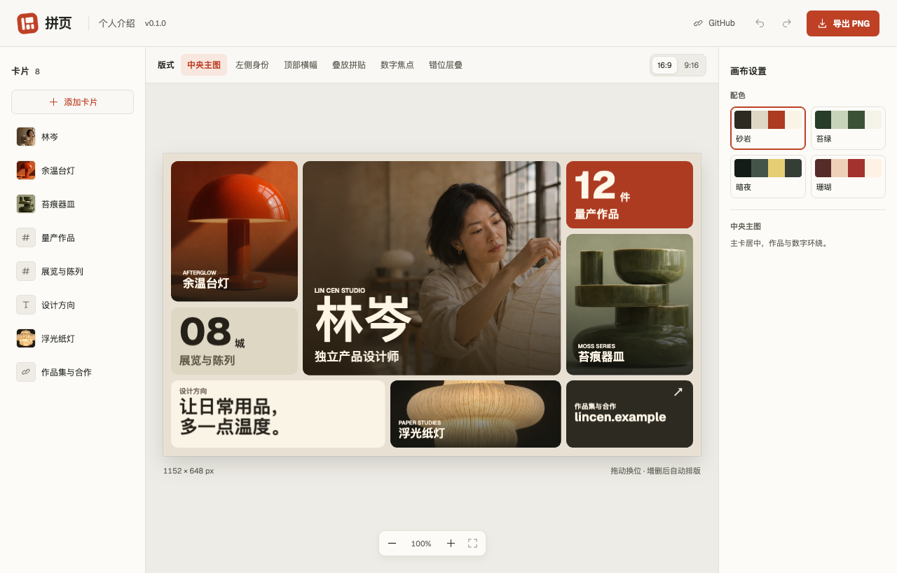
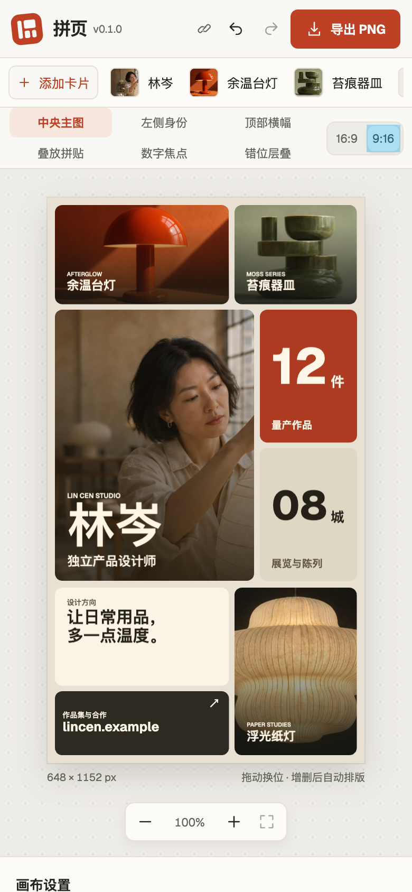

<p></p>

# 拼页 · Pingye

把照片、作品和成绩拼成一张个人海报。换一套版式，继续编辑同一份内容。

Turn photos, projects, and milestones into a personal Bento poster. Switch layouts and keep editing the same content.

**[在线体验 / Cloudflare Demo](https://xiaosang.cc/pingye/)** · [GitHub Repo](https://github.com/holynova/pingye)



## 从一张卡开始 / Make a poster

1. **填内容。** 添加身份、作品图、数字、短句、标签或链接。增删后，版式会自动调整。
2. **调整画面。** 六种版式共用一份稿件。点图片上的「裁剪」，可以拖动、缩放或拖四角调整取景。
3. **导出 PNG。** 横屏为 2304 × 1296，手机竖屏为 1296 × 2304。草稿和上传的图片保存在当前浏览器。

Add and reorder cards, switch among six layouts, and crop images by dragging the photo or its corners. Export at 2304 × 1296 for landscape or 1296 × 2304 for phones. Drafts and uploaded images stay in the current browser.

<details>
<summary>手机竖版与裁剪界面 / Phone layout and crop editor</summary>
<br>


</details>

## 本地运行 / Run locally

```sh
npm ci
npm run dev
```

## 发布 / Deploy

从项目 <code>main</code> 构建单文件产物，从作品集 <code>master</code> 手动发布到 Cloudflare。

Build from project <code>main</code>. Copy the output into the portfolio and deploy manually from its committed <code>master</code> checkout.

```sh
npm run deploy:check
cp dist/index.html "$PORTFOLIO_DIR/pingye/index.html"
# Commit and push the portfolio update on master, then deploy that checkout.
(cd "$PORTFOLIO_DIR" && npx --yes wrangler@4.128.0 deploy --config wrangler.jsonc)
```


